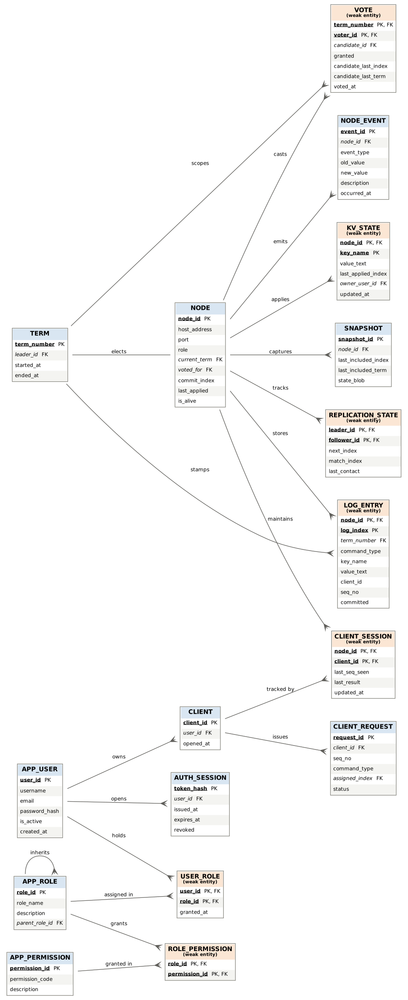
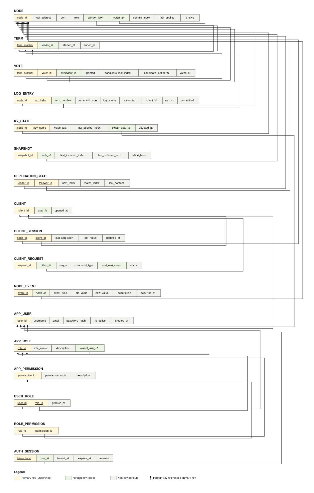

# ER Model, Relational Schema and Normalization





---

## 1. Entities

17 relations in four groups.

### Raft protocol state

| Relation | Weak? | Description |
|---|---|---|
| `NODE` | no | A server in the cluster: address, role, current term, vote, commit and apply progress |
| `TERM` | no | A logical clock interval. Terms increase monotonically; each has at most one leader |
| `VOTE` | **yes** | A vote cast by one node, in one term, for one candidate |
| `LOG_ENTRY` | **yes** | One entry in a node's replicated log |
| `REPLICATION_STATE` | **yes** | A leader's per-follower progress |
| `SNAPSHOT` | no | A compacted checkpoint up to a log index |

### Applied state machine

| Relation | Weak? | Description |
|---|---|---|
| `KV_STATE` | **yes** | The key-value pairs produced by applying committed entries |
| `CLIENT` | no | Client identity, cluster-wide |
| `CLIENT_SESSION` | **yes** | Per-replica deduplication state for a client |
| `CLIENT_REQUEST` | no | One client command and its outcome |

### Access control

| Relation | Weak? | Description |
|---|---|---|
| `APP_USER` | no | A dashboard user |
| `APP_ROLE` | no | A role, with `parent_role_id` forming a hierarchy |
| `APP_PERMISSION` | no | A named capability |
| `USER_ROLE` | **yes** | Bridge: users to roles |
| `ROLE_PERMISSION` | **yes** | Bridge: roles to permissions |
| `AUTH_SESSION` | no | An issued login session |

### Auditing

| Relation | Weak? | Description |
|---|---|---|
| `NODE_EVENT` | no | Written by triggers on every role, term, commit or liveness change |

### Why five relations are weak

`LOG_ENTRY`, `KV_STATE` and `CLIENT_SESSION` are each owned by a `NODE`
because **every replica keeps its own independent copy**. The same
`log_index` on two nodes may legitimately hold different entries until
the logs converge, so the index alone cannot identify an entry.

This is not a modelling nicety. An early version keyed `CLIENT_SESSION`
on `client_id` alone; all five replicas then shared one deduplication
row, and nodes that had not yet applied a command treated it as a
duplicate and skipped it. The replicas diverged silently. See
`DESIGN.md` §7.

### Non-simple attributes

The relational side is deliberately all atomic — first normal form.
Two attributes would naturally be composite or multi-valued and are
handled rather than stored as lists:

- A node's **address** is `(host_address, port)`, kept as two atomic
  attributes with a `UNIQUE` constraint over the pair.
- A node's **set of followers with their progress** is multi-valued, so
  it is extracted into `REPLICATION_STATE` instead of being a repeating
  group inside `NODE`.
- A role's **effective permissions** are derived, not stored — computed
  by the recursive view, so no transitive duplication exists.

The MongoDB side is where genuinely non-simple data lives: each event
document carries a 128-element embedding array and type-specific nested
fields.

---

## 2. Relationships

| Relationship | Cardinality | Notes |
|---|---|---|
| NODE stores LOG_ENTRY | 1:N | identifying |
| NODE applies KV_STATE | 1:N | identifying |
| NODE maintains CLIENT_SESSION | 1:N | identifying |
| NODE casts VOTE | 1:N | identifying |
| NODE captures SNAPSHOT | 1:N | |
| NODE emits NODE_EVENT | 1:N | |
| **NODE tracks NODE** | M:N | **recursive**, resolved into `REPLICATION_STATE` |
| **NODE voted_for NODE** | N:1 | **recursive**, self-referencing FK |
| TERM elects NODE | 1:0..1 | a split vote elects nobody |
| TERM scopes VOTE | 1:N | |
| TERM stamps LOG_ENTRY | 1:N | |
| CLIENT issues CLIENT_REQUEST | 1:N | |
| CLIENT tracked by CLIENT_SESSION | 1:N | one row per replica |
| **APP_ROLE inherits APP_ROLE** | N:1 | **recursive**, the role hierarchy |
| APP_USER holds APP_ROLE | M:N | via `USER_ROLE` |
| APP_ROLE grants APP_PERMISSION | M:N | via `ROLE_PERMISSION` |

Three recursive relationships, all load-bearing. `REPLICATION_STATE`
resolves an M:N whose two participating entity sets are both `NODE`, with
`leader_id` and `follower_id` as distinct foreign keys into the same
relation.

---

## 3. Relational schema

```sql
NODE(node_id PK, host_address, port, role, current_term -> TERM,
     voted_for -> NODE, commit_index, last_applied, is_alive)

TERM(term_number PK, leader_id -> NODE, started_at, ended_at)

VOTE(term_number -> TERM, voter_id -> NODE, candidate_id -> NODE,
     granted, candidate_last_index, candidate_last_term, voted_at)
     PRIMARY KEY (term_number, voter_id)

LOG_ENTRY(node_id -> NODE, log_index, term_number -> TERM,
          command_type, key_name, value_text, client_id, seq_no, committed)
          PRIMARY KEY (node_id, log_index)

KV_STATE(node_id -> NODE, key_name, value_text, last_applied_index,
         owner_user_id -> APP_USER, updated_at)
         PRIMARY KEY (node_id, key_name)

REPLICATION_STATE(leader_id -> NODE, follower_id -> NODE,
                  next_index, match_index, last_contact)
                  PRIMARY KEY (leader_id, follower_id)

SNAPSHOT(snapshot_id PK, node_id -> NODE, last_included_index,
         last_included_term, state_blob)

CLIENT(client_id PK, user_id -> APP_USER, opened_at)

CLIENT_SESSION(node_id -> NODE, client_id -> CLIENT,
               last_seq_seen, last_result, updated_at)
               PRIMARY KEY (node_id, client_id)

CLIENT_REQUEST(request_id PK, client_id -> CLIENT, seq_no, command_type,
               key_name, value_text, assigned_index, status)

APP_USER(user_id PK, username, email, password_hash, is_active)
APP_ROLE(role_id PK, role_name, description, parent_role_id -> APP_ROLE)
APP_PERMISSION(permission_id PK, permission_code, description)
USER_ROLE(user_id -> APP_USER, role_id -> APP_ROLE, granted_at)
          PRIMARY KEY (user_id, role_id)
ROLE_PERMISSION(role_id -> APP_ROLE, permission_id -> APP_PERMISSION)
                PRIMARY KEY (role_id, permission_id)
AUTH_SESSION(token_hash PK, user_id -> APP_USER, issued_at,
             expires_at, revoked)

NODE_EVENT(event_id PK, node_id -> NODE, event_type, old_value,
           new_value, term_number, description, occurred_at)
```

---

## 4. Functional dependencies

```
NODE              node_id → host_address, port, role, current_term,
                            voted_for, commit_index, last_applied, is_alive
                  {host_address, port} → node_id        (candidate key)

TERM              term_number → leader_id, started_at, ended_at

VOTE              {term_number, voter_id} → candidate_id, granted,
                            candidate_last_index, candidate_last_term, voted_at

LOG_ENTRY         {node_id, log_index} → term_number, command_type,
                            key_name, value_text, client_id, seq_no, committed

KV_STATE          {node_id, key_name} → value_text, last_applied_index,
                            owner_user_id, updated_at

REPLICATION_STATE {leader_id, follower_id} → next_index, match_index,
                            last_contact

CLIENT_SESSION    {node_id, client_id} → last_seq_seen, last_result

CLIENT_REQUEST    request_id → client_id, seq_no, command_type, status
                  {client_id, seq_no} → request_id      (candidate key)

APP_USER          user_id → username, email, password_hash, is_active
                  username → user_id                    (candidate key)
                  email    → user_id                    (candidate key)

APP_ROLE          role_id → role_name, description, parent_role_id
                  role_name → role_id                   (candidate key)

APP_PERMISSION    permission_id → permission_code, description
                  permission_code → permission_id       (candidate key)

AUTH_SESSION      token_hash → user_id, issued_at, expires_at, revoked
```

---

## 5. Normalization

### 1NF
Every attribute is atomic. The one multi-valued fact — a leader's set of
followers and their progress — is extracted into `REPLICATION_STATE`
rather than held as a repeating group.

### 2NF
No partial dependency on part of a composite key.

- `VOTE`: `granted` and `voted_at` depend on both `term_number` and
  `voter_id`. Neither alone determines them — the same voter votes in
  many terms, and many voters vote in one term.
- `LOG_ENTRY`: `command_type`, `key_name` and `value_text` depend on the
  full key. The same `log_index` on a different node may hold a
  different entry, which is precisely what makes this weak.
- `KV_STATE`: `value_text` depends on both node and key.
- `REPLICATION_STATE`: `next_index` and `match_index` are properties of
  the leader–follower *pair*.

### 3NF
No transitive dependency.

- `CLIENT_SESSION` holds no client attributes; those live in `CLIENT`.
  Keeping `opened_at` here would make it transitively dependent on
  `client_id` rather than on the whole key.
- `KV_STATE` stores the applied value, not the command that produced it;
  the command stays in `LOG_ENTRY`. Storing both would duplicate derived
  state.
- `USER_ROLE` and `ROLE_PERMISSION` hold no role or permission
  attributes.
- Effective permissions are **derived**, not stored — the recursive view
  computes them, so an inherited permission exists in exactly one place.

### BCNF
Every determinant is a candidate key.

Checked relation by relation. The only ones with more than one candidate
key are `NODE` (`node_id`, and `{host_address, port}`), `APP_USER`
(`user_id`, `username`, `email`), `APP_ROLE` (`role_id`, `role_name`),
`APP_PERMISSION` (`permission_id`, `permission_code`) and
`CLIENT_REQUEST` (`request_id`, `{client_id, seq_no}`). In each case
every determinant listed in §4 is one of those candidate keys, so **all
17 relations are in BCNF**.

No decomposition was required to reach BCNF, and none was performed —
decomposing further would split keys that the integrity constraints
depend on.

---

## 6. Key integrity constraints

**Election safety.** `PRIMARY KEY (term_number, voter_id)` on `VOTE`
makes a second vote in the same term structurally impossible. Raft's
election-safety property — at most one leader per term — is enforced as a
key constraint, not as application logic.

**Log matching.** `(node_id, log_index)` is unique and `term_number` is
recorded, so the log-matching property is checkable: if two nodes hold an
entry with the same index and term, every preceding entry is identical.

**Exactly-once clients.** `CLIENT_SESSION.last_seq_seen` together with
`CLIENT_REQUEST.seq_no` deduplicates retries. Without it the system is
at-least-once and a retried `APPEND` corrupts its value.

**Recursive integrity.** `app_role.parent_role_id` is a self-referencing
foreign key; the recursive CTE that walks it caps depth at 16 so a cyclic
hierarchy cannot produce infinite recursion.

**Cross-relation invariants** enforced by CHECK:
`last_applied <= commit_index`, `match_index < next_index`,
`expires_at > issued_at`, a write command must name a key, and a port
must be in range.

---

## 7. Mapping to the implementation

| Relation | Where it is used |
|---|---|
| `NODE` | `raft/node.py` — term, vote, role, commit progress |
| `TERM` | incremented by `_start_election` and `sp_start_election` |
| `VOTE` | written by `_record_vote_row`; guarded by `trg_vote_bi` |
| `LOG_ENTRY` | `_persist_append`, `_persist_truncate` |
| `KV_STATE` | `raft/store.py` — the applied state machine |
| `REPLICATION_STATE` | `_persist_replication_state`; read by `v_replication_lag` |
| `CLIENT_SESSION` | deduplication in `store.apply` and `sp_apply_committed` |
| `APP_*`, `USER_ROLE`, `ROLE_PERMISSION` | `dashboard/lib/auth.js` via `v_user_permission` |
| `NODE_EVENT` | written only by `trg_node_au` |
